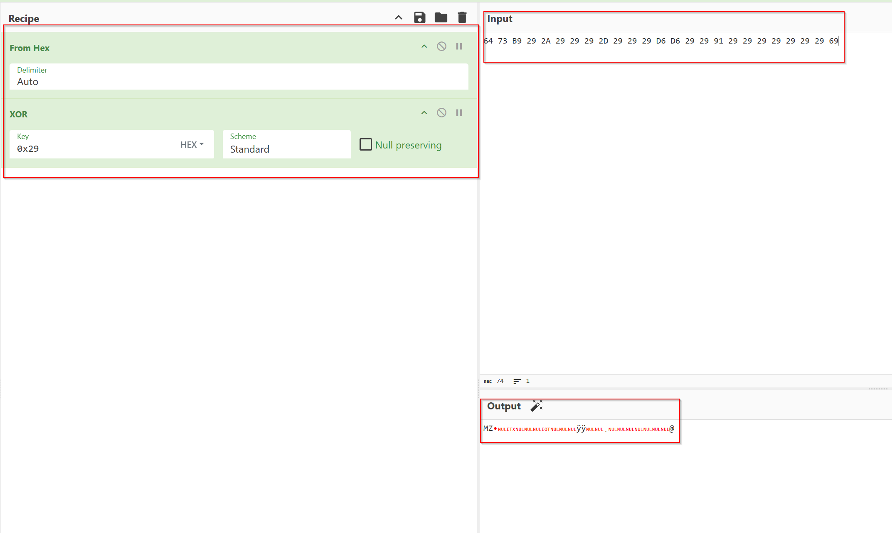
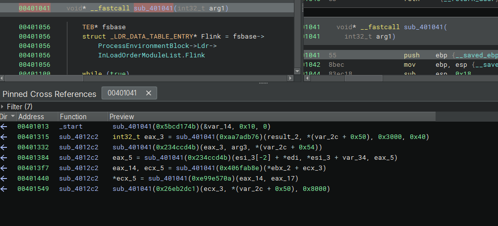

## Overview

This write-up covers the **RokRat Loader** challenge from Malops.io. The sample is a small 32-bit Windows console executable that behaves as a **loader for an embedded, XOR-encoded PE payload**. The work below is static analysis and code reversing only. The embedded payload was not extracted and analyzed on its own, and no dynamic analysis was performed.

**Key findings**

- The loader locates its payload using a position-independent get-EIP helper.
- The payload is encoded with a **single-byte XOR key (`0x29`)** stored in the first byte of the embedded blob.
- The decoded data is validated as a PE (`0x5A4D`, then `0x4550`) before use.
- Memory is allocated with `VirtualAlloc(0, SizeOfImage, 0x3000, 0x40)`, resolved through a **custom PEB-walking, hash-based API resolver**.
- Six distinct API hashes are resolved in the binary, and five of them were matched to API names.
- The "RokRAT" name comes from the challenge title only. No artifact in the loader ties the sample to APT37 or RokRAT.

## Sample Fingerprint

| Field | Value |
|---|---|
| Size | 20,572 bytes (20.09 KB) |
| MD5 | `cf28ef5ceda2aa7d7c149864723e5890` |
| SHA1 | `b9588ba133b2b31b95f656c21834a4af5bd8a0f9` |
| SHA256 | `59b7de24a5c4c5c325d3d44c58c4a30cd4f67792e0e9aed6f14560fc52c5fb35` |
| Format | PE32, i386, console, EXE, no exports |
| Entry point | RVA `0x1000`, VA `0x401000`, in `.text` |
| Image base / size | `0x400000` / `0x6000` |
| Compile timestamp | 2005-01-04 20:56:05 UTC (likely forged or template-derived) |
| Language | C++ |

## Static Analysis

### Tooling

Detect It Easy was used for initial identification, hashes, and entry point. PE-Bear and PEStudio were used for header and section review. capa and FLOSS provided behavioral and string triage, Binary Ninja was used for disassembly and decompilation, and CyberChef and a hex editor were used to validate the encoding.

### PE Structure

| Name | VA | Virtual size | Raw size | Raw offset | Entropy | Flags |
|---|---|---|---|---|---|---|
| `.text` (malformed name with a stray `0x14` byte) | `0x1000` | `0x4000` | `0x4000` | `0x1000` | 3.38 | RWX |
| `.Silvana` | `0x5000` | `0x1000` | 92 | `0x5000` | 2.49 | RW, initialized data |

**Imports (only two)**

- `KERNEL32.DLL`: `LoadLibraryA`
- `Ws2_32.dll`: `WSAStartup`

**Header anomalies**

- A `[LordPE]` string sits at file offset `0xEB`, which suggests the PE headers were edited with LordPE.
- The `.text` section is **RWX**, and the import strings live inside it rather than in a dedicated import section.
- The custom section name `.Silvana` and the malformed `.text` name point to a hand-built or tampered binary.
- Entropy is low across the whole file. The sample is not packed or strongly encrypted, and the payload is only lightly obfuscated with a single-byte XOR.
- **Open item:** FLOSS found section name strings at three offsets (`0x1D8`, `0x200`, `0x228`), while pefile reports only two sections. The `NumberOfSections` field and the third header slot should be reviewed.

A very small import table is a common sign that the binary resolves its real APIs at runtime. That is consistent with what the tool output shows next.

### Tool Correlation

| Behavior | DIE / PEStudio | FLOSS | capa |
|---|---|---|---|
| Encoded embedded PE | RWX `.text`, low entropy | `)` (`0x29`) padding and an encoded DOS stub | "contain an embedded PE file" at `0x1590`, "encode data using XOR" at `0x401149` |
| Dynamic API resolution | Only two imports | No API name strings, a decoding-style function with 14 xrefs | "PEB access", "access PEB ldr_data", "resolve function by parsing PE exports" |
| PE mapping | Custom `.Silvana` section | None | "enumerate PE sections" at `0x4012C2` |

capa also fired "reference analysis tools strings" on `[LordPE]`. This is a **false positive** for anti-analysis. The string is in the header region, not in code, so it indicates PE editing rather than an analysis-tool check.

## Challenge Walkthrough

### Question 1: MD5 hash of the binary

**Answer:** `cf28ef5ceda2aa7d7c149864723e5890`

Detect It Easy reports the hash directly.

### Question 2: Entry point address in hex

**Answer:** `0x401000`

Detect It Easy shows both the entry point and the image base. PE-Bear gives the same result when the entry point RVA (`0x1000`) is added to the image base (`0x400000`).

### Question 3: XOR key used to decrypt the embedded payload

**Answer:** `0x29`

1. capa reported **"encode data using XOR"** and **"contain an embedded PE file"**. PEStudio showed that `.text` is writable and executable, and the binary has very few imports, which suggests this outer file is not the main object of interest.
2. The capa embedded PE match carries a file offset of `5520`, which is `0x1590` in hex. Viewing that offset in a hex editor shows one byte, `0x29`, dominating the surrounding data. XOR-encoded null padding produces the key byte itself, so the dominant byte is a strong key candidate.
3. Taking the bytes from `0x1590` into CyberChef with the **From Hex** and **XOR** recipes, using `0x29` as the key, produces a valid `MZ` header.



**Additional validation.** The decoded header matches standard MZ values: `4D 5A`, `e_cblp = 0x90`, `e_cp = 3`, `e_cparhdr = 4`, `e_maxalloc = 0xFFFF`, `e_sp = 0xB8`, and `e_lfarlc = 0x40`. The encoded string near `0x15DE` also decodes to the standard DOS stub message, "This program cannot be run in DOS mode". Matching known plaintext in two separate places gives **high confidence** in the key.

In Binary Ninja, `sub_401134` confirms the same behavior in code. The first byte of its argument is loaded as the key, and the XOR loop at `0x401149` runs over the data that starts five bytes in.

### Question 4: Memory protection constant used for the payload allocation

**Answer:** `0x40` (`PAGE_EXECUTE_READWRITE`)

The loader resolves its APIs by hash through `sub_401041`. At `0x401307`, it pushes `0x40`, `0x3000`, and `[ebx+0x50]` (the `SizeOfImage` of the decoded PE) before calling the resolved function at `0x40131A`.

```nasm
004012ff  8b5dd8             mov     ebx, dword [ebp-0x28 {var_2c}]
00401302  b976db7aaa         mov     ecx, 0xaa7adb76
00401307  6a40               push    0x40 {var_44}
00401309  6800300000         push    0x3000 {var_48}
0040130e  895de4             mov     dword [ebp-0x1c {var_20_1}], ebx
00401311  ff7350             push    dword [ebx+0x50] {var_4c_1}
00401314  50                 push    eax {var_50_1}
00401315  e827fdffff         call    sub_401041
0040131a  ffd0               call    eax
0040131c  8907               mov     dword [edi], eax
0040131e  85c0               test    eax, eax
```

The stdcall convention pushes arguments right to left, so the **first push is the last parameter, `flProtect`**. The call is equivalent to `VirtualAlloc(0, SizeOfImage, MEM_COMMIT | MEM_RESERVE, PAGE_EXECUTE_READWRITE)`. Allocating RWX memory for a manually mapped payload is a typical loader pattern and a useful detection point.

*Note:* This conclusion comes from static reading of the call site. A breakpoint at `0x40131A` in a debugger would confirm the arguments at runtime.

### Question 5: Hash value used to find VirtualAlloc

**Answer:** `0xAA7ADB76`

1. The import table contains only `LoadLibraryA` and `WSAStartup`, and there are no API name strings, so the remaining APIs must be resolved by something other than names, most likely hashes.
2. capa flagged `PEB access`, `access PEB ldr_data`, and `resolve function by parsing PE exports` in function `0x401041`.
3. Binary Ninja identifies the function as `__fastcall`, so its single argument (`arg1`) arrives in `ecx`. The final comparison in the resolver is `(edi_4 ^ esi_1) == arg1`, which shows `arg1` is the target hash.
4. A `VirtualAlloc` call is recognizable by four pushed arguments, with `0x3000` as the third and a protection constant as the fourth. This matches the call site from Question 4, where `0xAA7ADB76` is loaded into `ecx` just before the pushes.

### Question 6: Rotate-right amount in the DLL name hash

**Answer:** `0xB`

`sub_401041` hashes each loaded module's `BaseDllName` in the loop at `0x40108C` to `0x4010A8`. The accumulator is rotated right by `0xB` before each byte is added. Bytes at or above `0x61` are upper-cased by subtracting `0x20`.

```nasm
0040108c  int32_t ebx = sx.d(*(Buffer + ecx))
00401090  int32_t esi_2 = ror.d(esi_1, 0xb)
0040109a  if (*(Buffer + ecx) s< 0x61)
004010a5      esi_1 = esi_2 + ebx
0040109a  else
004010a1      esi_1 = esi_2 + ebx - 0x20
```

The export-name hash is a separate loop and uses a different rotation of `0xF`. The two constants should not be confused. Using `0xB` and `0xF` instead of the widely seen ROR 13 also makes this resolver more distinctive for detection.

### Question 7: Value checked to verify a valid PE header

**Answer:** `0x4550`

The validation chain is:

- `sub_401134` decodes the payload and calls `sub_4012C2`.
- `sub_4012C2` calls `sub_4011F9` to validate the data before allocating memory.
- `sub_4011F9` calls `sub_401164`, which checks the MZ signature (`0x5A4D`), and then `sub_401197`.
- `sub_401197` reads `e_lfanew` from offset `0x3C`, bounds-checks it, and compares the dword at `base + e_lfanew` with `0x4550` (`PE\0\0`). A mismatch returns `0xBE`.

```nasm
004011bf  ecx_1 = arg3                      ; base of decoded PE (MZ header)
004011c8  esi = ecx_1[0xf]                  ; dword at offset 0x3C = e_lfanew
004011d8  eax_4 = esi + ecx_1               ; base + e_lfanew = NT headers
004011ea  if (*eax_4 != 0x4550) return 0xbe  ; PE signature check
```

`0x5A4D` is the DOS header check and is verified first, but the value that validates the **PE header** is `0x4550`. The data agrees with the code. The encoded bytes `79 6C 29 29` at file offset `0x16B8` decode to `50 45 00 00`, followed by `4C 01`, which is the i386 machine type.

### Question 8: Offset used to reach the export directory

**Answer:** `0x78`

At `0x401071`, the resolver reads the export directory RVA with the expression `*(*(DllBase + 0x3c) + DllBase + 0x78)`.

```nasm
00401071            int32_t eax_3 = *(*(DllBase + 0x3c) + DllBase + 0x78)
```

The offset `0x78` is measured from the NT headers: 4 bytes of signature, 20 bytes of file header, and `0x60` bytes into the PE32 optional header to reach `DataDirectory[0]`. The PE32 format confirmed by DIE and pefile rules out the PE32+ variant, which would use `0x88`.

After retrieving the export directory, the code reads the following fields, which also match the capa rule:

- `+0x18` NumberOfNames
- `+0x20` AddressOfNames
- `+0x24` AddressOfNameOrdinals
- `+0x1C` AddressOfFunctions

### Question 9: Number of APIs resolved by hashing

**Answer:** `6`

Pressing `X` on `sub_401041` in Binary Ninja lists its callers. There are 14 call sites, and extracting the `ecx` immediate at each one yields **six distinct hashes**. Repeated hashes are consistent with calls such as `GetProcAddress` inside an import-fixing loop.



To name the hashes, I reimplemented the algorithm in Python (written with help from Claude) and tested candidate API names against each module.

```python
MASK = 0xFFFFFFFF

def ror(v, n):
    return ((v >> n) | (v << (32 - n))) & MASK

def sx(b):
    if b >= 128:
        return b - 256
    return b

def modhash(name):
    h = 0
    data = bytearray(name.encode("utf-16le") + b"\x00\x00")
    for b in data:
        h = ror(h, 0xB)
        if b >= 0x61:
            h = (h + sx(b) - 0x20) & MASK
        else:
            h = (h + sx(b)) & MASK
    return h

def fnhash(name):
    h = 0
    data = bytearray(name.encode("ascii") + b"\x00")
    for b in data:
        h = (ror(h, 0xF) + sx(b)) & MASK
    return h

targets = set([0xaa7adb76, 0x5bcd174b, 0x234ccd4b,
               0x406fab8e, 0xe99e570a, 0x26eb2dc1])

mods = ["kernel32.dll", "ntdll.dll", "kernelbase.dll",
        "user32.dll", "ws2_32.dll", "advapi32.dll"]

apis = ("VirtualAlloc VirtualFree VirtualProtect LoadLibraryA "
        "GetProcAddress RtlMoveMemory CreateThread ExitProcess "
        "GetModuleHandleA WaitForSingleObject").split()

found = set()
for m in mods:
    mh = modhash(m)
    for a in apis:
        v = fnhash(a) ^ mh
        if v in targets:
            print("%s %s %s" % (hex(v), m, a))
            found.add(v)

print("tested %d names, matched %d of %d" % (len(apis), len(found), len(targets)))
```

```text
0xaa7adb76 kernel32.dll VirtualAlloc
0x26eb2dc1 kernel32.dll VirtualFree
0x406fab8e kernel32.dll LoadLibraryA
0xe99e570a kernel32.dll GetProcAddress
0x234ccd4b ntdll.dll RtlMoveMemory
tested 10 names, matched 5 of 6
```

**Resolved hash table**

| Hash | Module | API | Likely role |
|---|---|---|---|
| `0xAA7ADB76` | kernel32.dll | VirtualAlloc | Allocate the RWX region (confirmed at the call site) |
| `0xE99E570A` | kernel32.dll | GetProcAddress | Resolve payload imports |
| `0x406FAB8E` | kernel32.dll | LoadLibraryA | Load payload DLLs |
| `0x26EB2DC1` | kernel32.dll | VirtualFree | Free a temporary buffer |
| `0x234CCD4B` | ntdll.dll | RtlMoveMemory | Copy headers or sections |
| `0x5BCD174B` | Unresolved | Unknown | Not in the candidate list |

A 32-bit hash match is strong evidence, but the matched names come from a limited candidate list and should be re-verified against full export lists. The roles in the last column are inferred from the API names, not read from code. One caveat applies to the count of six: no second resolver was observed, and capa flagged PEB access only in `0x401041`, but not every function in the binary has been reviewed.

### Question 10: Header bytes skipped to reach the decoded data

**Answer:** `5`

`sub_401134` reads the key from `*arg1`, a length value from `*(arg1 + 1)`, and starts both the XOR loop and the call into the mapper at `&arg1[5]`.

```nasm
00401135  ebx.b = *arg1          ; byte 0: XOR key
0040113a  i_2 = *(arg1 + 1)     ; bytes 1 to 4: length field
00401145  eax = &arg1[5]        ; data pointer starts at arg1 + 5
00401149  *eax ^= ebx.b         ; XOR loop begins at arg1 + 5
00401153  sub_4012c2(eax, i_2, &arg1[5], arg2)   ; decoded data passed to the mapper
```

The blob begins at `0x40158B`, and the encoded MZ header sits at `0x401590`, five bytes later. That is **1 byte for the key plus a 4-byte length field**.

## Deeper Reversing

### Locating the Payload

The code that returns the blob address uses a position-independent get-EIP technique. A `call` at `0x40157C` targets a helper at `0x401583` (`mov eax, [esp]; ret`), which returns `0x401581`. The following routine adds `0xA` to that value, so the function returns **`0x40158B`**, the start of the embedded blob. This makes the loader independent of its load address.

### Embedded Blob Layout

| Offset from blob start | File offset | Size | Content |
|---|---|---|---|
| +0 | `0x158B` | 1 | XOR key `0x29` |
| +1 to +4 | `0x158C` | 4 | Length field (bytes `00 8C 0D 00`) |
| +5 | `0x1590` | n | XOR-encoded PE, header begins `64 73 B9 ...` |

The decoded `e_lfanew` is inferred to be `0x128`, because the encoded PE signature sits at `0x16B8`, which is `0x1590 + 0x128`.

**Unresolved: length field.** Read as a plain DWORD, the length bytes give `0x000D8C00` (887,808), which is far larger than the whole file. The payload is likely only 5 to 13 KB, based on where the import strings and the end of the blob fall. Either the field is not used as a plain DWORD, or the decompiler output is misleading. The instruction at `0x40113A` (`mov` versus `movzx`, DWORD versus byte) needs to be checked.

### Reconstructed Execution Flow

| Step | Function | Status | Description |
|---|---|---|---|
| 1 | `0x401000` | Entry only | Entry point. The code between the entry and the helpers was not read. |
| 2 | `0x40157C` / `0x401583` | Reviewed | Get-EIP helper returns the blob address `0x40158B`. |
| 3 | `sub_401134` | Reviewed | Reads the key, runs the XOR loop at `0x401149` over `blob + 5`, then calls the mapper. |
| 4 | `sub_4012C2` | Partly reviewed | Rejects a null output pointer, zeroes the output structure, and calls the validator. |
| 5 | `sub_4011F9` | Reviewed | Calls the MZ check (`0x5A4D`) and the NT header check (`0x4550`). |
| 6 | Allocation | Reviewed | `VirtualAlloc(0, SizeOfImage, 0x3000, 0x40)` through the hash resolver. |
| 7 | Map and run | **Inferred** | Section copy, import fixing with `LoadLibraryA` and `GetProcAddress`, possible relocations, `VirtualFree` of a temporary buffer, and transfer of control. |

Step 7 is an inference from the resolved API set and the capa "enumerate PE sections" match at `0x4012C2`. The section copy, import fixing, relocation handling, and final jump were not read in code.

### Hash Algorithm Summary

The resolver (`sub_401041`, argument in `ecx`) works as follows:

- It walks `PEB->Ldr->InLoadOrderModuleList` until `DllBase == 0`.
- **Module hash:** for each byte of `BaseDllName.Buffer`, over `MaximumLength` bytes (which includes the wide terminator), `h = ror32(h, 0xB)`, then `h += signext(byte)`, minus `0x20` if the byte is `0x61` or above.
- **Function hash:** for each byte of the export name including the null terminator, `h = ror32(h, 0xF) + signext(byte)`.
- A match occurs when `function_hash ^ module_hash` equals `arg1`.

The reproduced hash only matches when the module hash runs over `MaximumLength`. Using `Length` instead gives `0x917C6D46`. This detail matters for anyone reimplementing the algorithm.

## Assessment

### Hypothesis Status

| Hypothesis | Confidence | Status |
|---|---|---|
| Embedded PE with single-byte XOR key `0x29` at file offset `0x1590` | High | **Confirmed** by decode and code |
| Custom hash-based API resolution through PEB walk and export parsing | High | **Confirmed** (algorithm reproduced) |
| Manual, reflective-style PE mapping into RWX memory | High for decode, validate, and allocate. Medium for copy, import fix, relocation, and jump | **Partly confirmed** |
| Hand-built or tampered PE (LordPE, `.Silvana`, RWX `.text`, import data in `.text`) | High that the file was edited | Header evidence only, intent not established |
| Network capability (`WSAStartup` import) | Unknown | Likely lives in the payload, no C2 strings in the loader |
| Attribution to RokRAT or APT37 | Unproven | Challenge label only |

### Attribution

Nothing in the loader supports attribution. There are no C2 strings, no cloud API strings, and no campaign markers. The `WSAStartup` import hints at networking, but that capability most likely belongs to the payload. Attribution to RokRAT or APT37 should be treated as **unproven** until the decoded payload shows matching indicators.

### IOCs and Detection Ideas

**File**

- MD5, SHA1, and SHA256 values from the fingerprint table
- Section name `.Silvana`, the `[LordPE]` string at `0xEB`, and a stray `0x14` byte in the `.text` name
- Compile timestamp 2005-01-04 20:56:05 UTC
- `LoadLibraryA` (KERNEL32) and `WSAStartup` (Ws2_32) as the only imports

**Algorithm and data**

- XOR key `0x29` in the first byte of the embedded blob, with the encoded MZ header `64 73 B9 29 2A 29 29 29 2D`
- Hash constants as they appear in `mov ecx, imm32` (little-endian):

| API | Bytes |
|---|---|
| VirtualAlloc | `76 DB 7A AA` |
| GetProcAddress | `0A 57 9E E9` |
| LoadLibraryA | `8E AB 6F 40` |
| VirtualFree | `C1 2D EB 26` |
| RtlMoveMemory | `4B CD 4C 23` |
| Unresolved | `4B 17 CD 5B` |

- The unusual rotation pair (module ROR `0xB`, function ROR `0xF`) distinguishes this resolver from the common ROR 13 hashing.

**Network and host:** none observed.

A YARA rule combining the hash-constant set with the encoded MZ header pattern is a reasonable starting point. A weaker, lower-confidence combination is a PEB walk together with `[LordPE]` and `.Silvana`. Neither rule has been tested.

### Next Steps

1. Read the remainder of the loader: the entry code, `sub_401164`, `sub_40123D`, `sub_401282`, and the unviewed part of `sub_4012C2` (section copy, import fixing, relocations, and the final jump).
2. Resolve the length field by checking the instruction at `0x40113A`.
3. Identify hash `0x5BCD174B` using full export lists for kernel32, ntdll, and kernelbase.
4. Decode the payload with XOR `0x29` from file offset `0x1590`, carve a clean PE, hash it, and run capa, FLOSS, DIE, and PEStudio on it. This is where any network or RAT behavior would appear.
5. Confirm the allocation in a debugger with a breakpoint at `0x40131A`, then dump the allocated region after mapping.
6. Review the header anomalies, including `NumberOfSections`, the third section header slot at `0x228`, the imphash, and the Rich header.

## Conclusion

The RokRat Loader sample is a compact, hand-edited loader that decodes an embedded PE with a single-byte XOR, validates it, and allocates executable memory using a custom hash-based API resolver. Every challenge answer is supported by both code and data. The remaining open work is to read the rest of the mapping routine and to analyze the decoded payload, which is where behavior and attribution can actually be assessed.